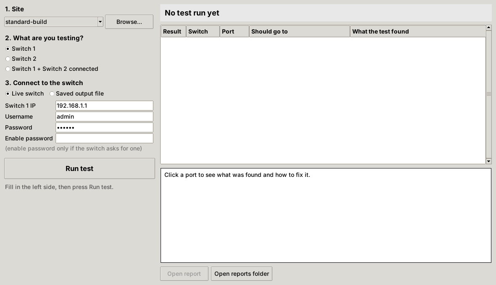
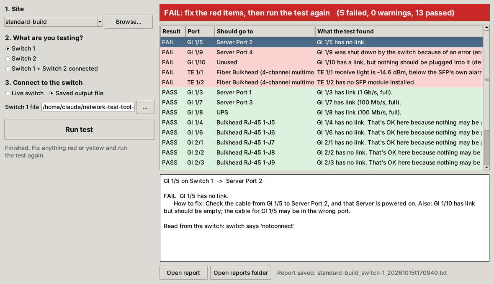
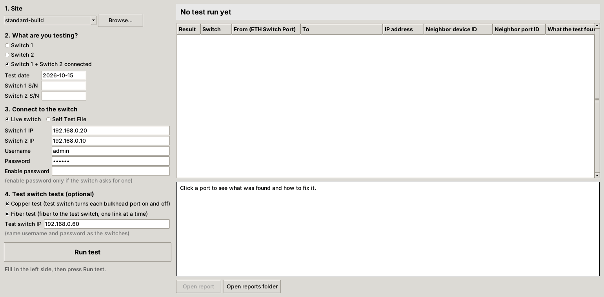

# Network Test Tool

A tool for field techs to confirm that Cisco ESS 3300 switches are cabled the
way the wiring diagrams say. It will log in to each switch over SSH, read link
status, speed, CDP/LLDP neighbors, MAC addresses and SFP light levels, and
compare them to a JSON config. Each port gets a pass, warn or fail result.

Testing happens in three modes: Switch 1 alone, Switch 2 alone, then both
switches connected together. The connected mode can also run two optional
tests through an external test switch: a copper test of Room 1's bulkhead
jacks and a fiber test (see below).

## Running a test (the window)

```
pip install -r requirements.txt
python -m nettest
```

On Linux, tkinter may need installing first (`sudo apt install python3-tk`);
the Windows installer from python.org includes it.

1. **Site**: pick the folder under `configs/` for the site (or Browse to one).
2. **What are you testing?**: Switch 1, Switch 2, or both connected. Under
   the choices, check the test date (today's date is filled in) and type
   each switch's S/N if you have it (up to 10 letters, numbers or dashes;
   one box per switch, so two for the combined test; can be left blank).
3. **Connect to the switch**: type the switch IP, username and password, or
   choose *Self Test File* to check a saved PuTTY log instead.
4. **Test switch tests (optional)**: only shown for *Switch 1 + Switch 2
   connected*. Tick *Copper test* and/or *Fiber test* and type the test
   switch IP (it uses the same username and password as the switches).
5. Press **Run test**.



The banner turns green, yellow or red. Problems are listed first; click any
port to see what the switch reported and how to fix it.
The IP address column shows the device's IP when the switch knows it (from
its device-tracking table, its ARP table, or CDP/LLDP); it's blank for a
device the switch hasn't talked to. The Neighbor device ID and Neighbor port ID
columns show what the device on the port announces over CDP or LLDP (its
name, and the port on its end); they're blank for devices that don't use
either, which is common for end devices. Every run is saved to
`reports/<site>/` as a `.txt` report (and a `.json` copy), with the test date
and any serial numbers in the report (serials also go in its file name), and *Open report* opens it. The window remembers the site, test, IPs and username between runs,
never the password or serial numbers.



## Running a test (command line)

The same engine runs from the command line. Needs Python 3.9+ and
`pip install -r requirements.txt`.

```
# Live: one switch (asks for the password)
python -m nettest configs/standard-build/switch1.json --host 192.168.0.20 --user admin

# Live: both switches connected
python -m nettest configs/standard-build/combined.json \
    --host switch1=192.168.0.20 --host switch2=192.168.0.10 --user admin

# Offline: from saved show-command output
python -m nettest configs/standard-build/switch1.json --offline switch1-session.log

# Save a .txt and .json report
python -m nettest ... --save reports --site "Site 7"
```

Exit code is 0 when everything passed, 1 for warnings, 2 for failures and 3
when a switch couldn't be read.

### Copper and fiber tests (test switch)

Both run inside the **Switch 1 + Switch 2 connected** test, after the normal
checks. The tool logs in to the external test switch over SSH (same username
and password as the switches) and turns its ports off and on itself; you
never log in to the test switch. Pick either test or both. The copper test
doesn't use the fiber, so it still works if the fiber has failed.

Cabling:

```
Laptop ── test switch spare port (any port not listed below)
          test switch Gi1/1 ── 1-J6 ── Switch 1 Gi1/6            control link, tested last
          test switch Gi1/2-9 ── 1-J7...1-J15 ── Switch 1        turned on one at a time
          test switch Te1/1, Te1/2 ── fiber bulkhead ── Switch 1 Te1/1, Te1/2
          Switch 1 Gi1/4 ── 1-J5 ── 2-J4 ── Switch 2 Gi1/5       room link, not touched
```

```
python -m nettest configs/standard-build/combined.json \
    --host switch1=192.168.0.20 --host switch2=192.168.0.10 \
    --host test_switch=192.168.0.60 --user admin --copper --fiber
```

**Copper test:**

1. Every bulkhead-facing test-switch port and both fiber ports are turned off,
   except the control port (Gi1/1, which carries the laptop's connection).
2. For each jack, its test-switch port is turned on. It passes when only the
   expected Switch 1 port comes up, at 1000 Mb/s full duplex, and goes down
   again when the port is turned off.
3. The control jack (1-J6) is tested last. A jack that already passed is
   turned on to carry the connection while the control port is turned off and
   back on.

| Result | Meaning |
|---|---|
| Pass | Only the expected Switch 1 port came up, at the expected speed and duplex, and went back down |
| Fail: no port came up | Open cable, wrong jack, or bad termination |
| Fail: brought up a different port | Cables swapped; names the other jack when it's one of the bulkheads |
| Fail: came up at 100 Mb/s | One of the four wire pairs is broken or miswired |
| Fail: half duplex | Damaged pair or bad patch cable |
| Fail: link with every test-switch port off | The jack is plugged into something other than the test switch |
| Warn: control jack not tested | No other jack passed, so nothing could carry the connection while 1-J6 was off |

**Fiber test:** the copper jacks are turned off (the control jack stays on as
a backup path) and both fiber ports are turned on. For each fiber link it
checks link at 10 Gb/s, SFP light levels, that CDP shows the expected test
switch port on the far end (catches crossed fibers), and that the port is
bundled in the EtherChannel. Then it turns each fiber port off in turn and
pings Switch 1 from the test switch, to prove traffic keeps flowing over the
other link.

At the end every test-switch port the tool touched is turned back on, even if
the test stops part way. Nothing is saved on the test switch (no
`write memory`), so reloading it restores its saved config.

The test switch's ports are listed in the `test_switch` section of
`combined.json` (`copper_test.jacks` with each jack's `switch_port` and
`test_switch_port`, the control jack marked `"control": true`, and
`fiber_test.links`). Change the test-switch ports to match how the test
switch is actually cabled.



### What it reads

Over SSH it runs these commands on each switch:

```
show interfaces status
show cdp neighbors detail
show lldp neighbors detail
show mac address-table
show interfaces transceiver detail
show ip arp                      (IP column only)
show device-tracking database    (IP column only)
show running-config | include ^hostname
```

For offline mode, give it either a saved terminal session (a PuTTY log or a
copy-paste of the window, with the `Switch#show ...` prompt lines left in;
abbreviations like `sh int status` are fine) or a folder with one file per
command named `show_interfaces_status.txt`, `show_cdp_neighbors_detail.txt`,
`show_lldp_neighbors_detail.txt`, `show_mac_address_table.txt`,
`show_interfaces_transceiver_detail.txt` and optionally `hostname.txt`.
A missing command only turns off the checks that need it.

### What it checks

| Check | Pass | Warn | Fail |
|---|---|---|---|
| Link | Up when it should be, or down on an optional (bulkhead) port | Optional port shut down in config | No link, err-disabled, shut down, link on a port that should be empty |
| Duplex | Matches `duplex` | Half duplex when full is expected | |
| Speed | Only checked if a port or default sets `speed_mbps` (off in the standard configs) | Different from `speed_mbps` | |
| Neighbor (`cdp_neighbor`) | CDP/LLDP sees the right switch on the right port | CDP and LLDP both off | Nobody seen, wrong device, or right switch but wrong port |
| MAC (`mac_addresses`) | Expected MAC seen on the port | MAC table unavailable | MAC missing, or seen on another port (swapped cables) |
| SFP | Present and the expected type | Different optic type | No SFP installed |
| Light levels | Within range | Between the SFP's warning and alarm levels | Past the SFP's alarm level (or outside the config range when the SFP has no thresholds), or no light at all |
| Device IP (`ip_address`) | Device's IP matches the one in the config | Device has a different IP | (never fails; ports with no `ip_address`, or no IP seen, aren't checked) |
| Unlisted ports (internal ports like AppGigabitEthernet are skipped) | | Link up and `unlisted_ports: warn_if_up` | Link up and `unlisted_ports: fail_if_up` |

Receive light is only checked when the link is up; transmit light is checked
whenever an SFP is installed.

### Using the engine from code

```python
from nettest import load_test, run_test, find_tests, SshCollector, OfflineCollector

find_tests("configs/standard-build")          # [(label, path), ...] for a picker
plan = load_test("configs/standard-build/combined.json")
report = run_test(plan, {
    "switch1": SshCollector("192.168.0.20", "admin", "password"),
    "switch2": OfflineCollector("saved/switch2.log"),
}, on_progress=print)

report.status                    # Status.PASS / WARN / FAIL / NOT_CONFIGURED
for port in report.ports():
    port.status, port.diagram_label, port.target, port.summary
    for f in port.findings:      # each has .message and, when something's wrong, .action
        ...
report.save("reports", site="Site 7")
```

A switch that can't be reached shows up as `report.switches[i].error`
instead of raising, so one bad switch doesn't lose the other's results.

### Tests

```
pip install -r requirements-dev.txt
python -m pytest
```

The tests run the engine against saved ESS 3300 output in `tests/samples/`
(good and faulty Switch 1, Switch 2, and both switches connected).

## Configs

```
configs/standard-build/
  switch1.json    Switch 1 wiring
  switch2.json    Switch 2 wiring
  combined.json   both switches connected, the link between them, and the
                  test switch ports for the copper and fiber tests
schema/
  switch-config.schema.json
  combined-config.schema.json
```

Copy `configs/standard-build/` to a new folder if a site is wired differently.

### Switch config (`switch1.json`, `switch2.json`)

| Field | Meaning |
|---|---|
| `schema_version` | Always `1` for now. |
| `switch` | `id` (used by `combined.json`), display `name`, `model`. |
| `defaults.copper.expect` | What every copper port should show unless the port overrides it (link up, full duplex). Speed isn't checked unless a `speed_mbps` is added. |
| `expect.ip_address` | The IP the device on this port should have, e.g. `"192.168.0.11"`. Optional: leave it out when the IP isn't known and the port's IP isn't checked. A match passes; a different IP is a warning. The IP comes from the switch's device-tracking and ARP tables, so a device that hasn't been seen isn't checked. |
| `unlisted_ports` | What to do with ports not in the list: `ignore`, `warn_if_up` or `fail_if_up`. |
| `ports[]` | One entry per cabled port. |

Each port:

| Field | Meaning |
|---|---|
| `interface` | Full IOS name, e.g. `GigabitEthernet1/3`, `TenGigabitEthernet1/1`. |
| `diagram_label` | How the port is shown to the tech (`GI 1/3`, `TE 1/1`). |
| `media` | `copper` or `fiber`. |
| `connects_to` | `device`, `port` (or `null` if the drawing shows none), and `kind`: `device`, `bulkhead` (passive patch point), `switch`, or `unused` (on the drawing but empty: give it `"expect": {"link": "down"}` so the test fails if something is plugged in; skipped if the switch doesn't have the port). |
| `optic` | Fiber only: SFP part number, type, wavelength, multimode/singlemode. |
| `expect` | Overrides for this port: `link` (`up`, `optional`, `down`), `speed_mbps`, `duplex`, `cdp_neighbor`, `mac_addresses`, `light_levels_dbm`. |
| `note` | Plain-English note shown to the tech. |

Bulkhead ports use `link: optional` because a passive bulkhead only shows link
when something is plugged into its far side.

Fiber light levels: the checker uses the thresholds the SFP reports about
itself (`use_module_thresholds: true`) and falls back to the `tx`/`rx` ranges
in dBm, which come from the optic's datasheet (FS.com SFP-10GSR-85I: transmit
-6.0 to -1.0 dBm, receive -11.1 to +0.5 dBm).

### Combined config (`combined.json`)

Lists the two switch configs to run together and the `interconnects` between
them. Each interconnect names both ends (`a`, `b`: switch id and interface),
the `media`, any bulkheads along the `path`, and what to `expect` (link up and
each switch seeing the other as a CDP neighbor). In the combined test the
interconnect's `expect` replaces each end port's standalone `expect`, so a
bulkhead port that was optional on its own must have link when the switches
are joined (settings the interconnect doesn't mention, such as light levels,
are kept). An entry with `"placeholder": true` is not filled in yet and is
reported as "not configured" rather than failed.
